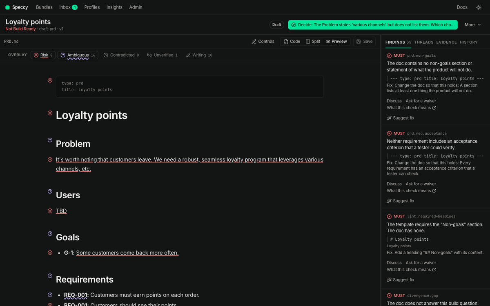

import VerdictInputs from '../../../components/diagrams/VerdictInputs.astro';

This page explains the one answer Speccy gives about a spec doc, and the rules behind it.

A verdict is Build Ready or Not Build Ready. Build Ready means that an implementer can build the thing without asking the author what they meant. Speccy computes the verdict from the findings and the decisions. No person and no model sets it.

<VerdictInputs />

## One verdict for each spec doc

Each spec doc has its own profile, its own review runs and its own verdict. A bundle with a PRD and an SDD has two verdicts. The file tree marks each spec doc with its verdict.

The bundles screen shows one state for each bundle: the worst state of its spec docs. One Not Build Ready spec doc makes the bundle row Not Build Ready. The row says Build Ready only when every spec doc is Build Ready.

## What decides it

Speccy computes the verdict with one pure function. It reads no clock, no file and no model, so the same input always gives the same verdict. The verdict is Build Ready only when all of these hold:

- No open MUST finding is a material gap.
- No blocking thread is open on the spec doc.
- The spec doc has the upstream link that its profile requires at MUST, or a standalone acknowledgement in its sidecar.

SHOULD findings and INFO findings never change the verdict. A SHOULD finding lowers the score. An INFO finding is a hint.

## Material gaps

A material gap is a place where a builder who cannot ask the author must guess, and a wrong guess changes one of these:

- the data model,
- a public interface,
- security,
- what the user sees.

Only a material gap blocks Build Ready. A gap that changes nothing of these is advice, even when its check is a MUST.

After each model stage, the judge reads each MUST finding of that stage. For each finding, the judge names two plausible answers that a builder could pick. When the two answers differ in one of the four ways, the finding is a material gap. Its consequence class names the way, such as Data model. The judge also suggests the answer that fits the rest of the doc better. When the judge cannot name two such answers, the finding is advice. The rail and the counts then show it as a SHOULD finding.

These MUST findings block without the judge:

- A finding of a check that needs no model, such as `frontmatter.readable`. The profile level decides.
- A MUST finding that the judge did not read, for example because the judge call failed. The next review asks the judge again.
- A MUST check that the reviewer gave no answer for.

A placeholder such as TBD becomes a build question for the judge. It blocks only when it is a material gap.

## The questions screen

The next action "Answer 3 questions" opens the questions screen. **More → Questions** in the control row opens it too. It lists, in doc order, everything that blocks Build Ready and needs a person. All items show on one page. An item is one of four kinds:

- **A material gap**, with its two options. The suggested option has a mark. Pick an option, write another answer under **Other**, or pick **Not needed** and say why.
- **A blocking thread**, shown inline. Reply in it, or click **Resolve**.
- **A decision finding.** A `trace.coverage` gap offers its three answers. A `coherence.downstream-request` offers **The downstream doc must change**. A `links.has-upstream` finding offers a link fix or **Mark it standalone**. A `coherence.contradiction` offers **The linked doc must change**.
- **Any other open MUST finding**, with **Suggest fix** or **Answer and fix**, and **Ask for a waiver**.

Open decisions are threads that do not block. They are not items, and they stay in the threads panel. A gap whose acknowledgement waits for approval is not an item. The approver sees the request instead. When a MUST check came back with no answer, the screen shows **Check again** at the top instead of an item.

Waivers that wait for your decision show at the top of the screen, under **Waiting for your decision**. Each one is the waiver card, with **Approve** and **Reject**. **Reject** asks for a decision reason of at least 20 characters. The same requests also wait in the **Inbox** and on the finding in the findings rail.

In reviewer mode, **Answer the questions** opens the same screen. A reviewer sees the same items, with no option pickers and no answer controls. A reviewer clicks **Comment** on an item to open a thread on its finding. A reviewer can reply in a blocking thread.

The rest of this section is about material gaps.

Speccy starts to write an answer into the doc when you pick it. **Write answers** shows one diff for each part of the doc that changes. Two answers about one paragraph share one diff. **Accept and check again** saves one version and starts a review. The review reads only the sections that changed.

**Not needed** needs no approval. Speccy writes it to the sidecar at once, bound to the one question. It ends when its section changes.

While a review runs, the questions screen shows each question as the judge finds it. You can pick answers before the review ends.

A thread can become blocking after the run. Speccy applies the thread rule each time it shows the verdict, so the verdict turns Not Build Ready at once. When a person resolves the thread, the result of the run comes back.

The profile sets the level of each check. The [Check catalog](/reference/checks/) lists the level of each built-in check, and [Profiles and size](/concepts/profiles-and-size/) says how a profile changes one.

## What acts on a finding first

Three things act on the findings before the rules run:

- **A waiver** excuses one check in one section. A valid waiver takes its finding out of the verdict. The verdict counts the waivers it used, such as "Build Ready (1 waiver)".
- **An acknowledgement** says that a link or a trace item is absent on purpose. A standalone acknowledgement meets the upstream link rule. A trace acknowledgement closes a coverage gap.
- **A relaxed check** reports at INFO, so it never blocks. A repo in adoption mode lists relaxed checks under `adoption.relaxed` in `.speccy.yaml`. The control row then says how many checks the repo relaxes, such as "Adoption mode: 3 checks relaxed".

Take a slug out of `adoption.relaxed`, and the check reports at its own level again. [Waivers and the sidecar](/concepts/waivers-and-the-sidecar/) explains waivers and acknowledgements. [Adopt a repo](/how-to/adopt-a-repo/) explains adoption mode.

## Lint verdicts and full verdicts

Speccy lints each new version of a spec doc at once. Lint needs no model, so each version gets a verdict. The control row says "Lint checks only" beside a lint verdict.

A full review adds the model stages: rubric, grounding, divergence and coherence. Its verdict counts their findings too. [The review pipeline](/concepts/review-pipeline/) explains each stage.

Speccy also lints the current version again in two cases. A change to the sidecar is the first case, because an approved waiver changes the verdict. A new version of the profile is the second case.

## Carried findings

An edit does not throw away the last full review. When you save a new version, Speccy lints it, and it carries the AI findings of the last full review into the new verdict. A carried finding counts in the verdict of the current version, and the rail lists it.

Speccy carries a finding only while its section has the same text. A finding in a section you changed drops out, because no model read the new text.

A whole-doc finding is the exception. It is a finding of a whole-doc check, or a rubric finding with no quote, which says that content is missing. It stays in the verdict after an edit, until the next full review judges its check again. So a save cannot make the doc Build Ready by mistake.

A later full review raises a new finding of a whole-doc check only in text that changed since the last full review. It judges each finding of the last review again. Thus each round of review ends with fewer findings. To have the whole doc judged again, ask for a fresh review: click **Write a fresh set at the next review** on the **Evidence** tab.

Two more cases use the same rule:

- **A run with fewer stages.** `speccy review --stages divergence` judges only the divergence stage. The findings of the stages it skips carry from the last run that did those stages.
- **A save during a review.** A full review can end on an old version, because the author saved while it ran. Speccy then carries its findings to the current version at once.

The control row names the review the carried findings come from, such as "AI review from v2 · 1 section changed". In the rail, a carried finding shows "From the review of v2". Run the review again to cover the changed sections. The unchanged sections come from the cache, so they cost nothing.

## The trend between two full reviews

After the second full review of a spec doc, the **Findings** tab shows one line of counts. An example is "Since the review of v3: 4 fixed, 2 still open, 1 new". The line compares the full review with the full review before it.

The line counts the open MUST and SHOULD findings. Its unit is one check in one section, or one build question. So a finding that the model words differently is still open, and it is not new. A new finding carries a "New" mark.

## A stale verdict

A verdict belongs to one version of one spec doc, read against the versions of its linked docs. When one of those moves on, the verdict reads Stale:

- **The spec doc has a newer version.** The control row says **Stale**, followed by the current version, such as `v4`. The next review gives the current version its own verdict.
- **A linked doc has a newer version than the run read.** Speccy lints the spec doc again at once, so a lint verdict never stays stale for this reason. A full verdict stays stale, so its model results stay on the screen. The control row names the linked doc that changed, such as "Stale · Refunds PRD changed after this review". The name links to that spec doc.
- **The last full review of the current version failed.** The control row says "The last review failed, so this verdict is stale." and gives the cause.

A stale verdict is not a finding. Only a new run replaces it. A builder cannot take the build packet of a stale verdict without the `acknowledged` flag, and nobody can approve a spec doc with a stale verdict.

## The score

The score is the number of passed checks divided by the number of applicable checks, as a whole number from 0 to 100. The score counts a waived check as passed. It leaves out INFO checks, and checks that do not apply, such as a check for a larger size. With no applicable check, the score is 100.

The run report splits the score into six categories: Structure, Clarity, Completeness, Evidence, Precision and Coherence.

The score is for metrics. It never decides the verdict. A spec doc with a score of 95 and one open material gap is Not Build Ready.

## Approvals come after the verdict

Approvals change the status of a spec doc, never its verdict. The status is Draft, In review, Approved or Superseded.

- An approval needs a current Build Ready verdict.
- An author cannot approve their own bundle.
- The status becomes Approved when the approvals of the current version reach `approvals.required` in the profile.
- A new version revokes the approvals, and an approved spec doc goes back to In review.
- A `supersedes` link from another bundle makes the status Superseded.

## The verdict outside the app

`speccy review` gives the same verdict in a terminal, and the GitHub Action gives it on a pull request. In advisory mode, a Not Build Ready verdict never fails the job. In blocking mode, `speccy review` exits with code 1. [Keep the verdict in CI](/how-to/keep-the-verdict-in-ci/) shows both.
